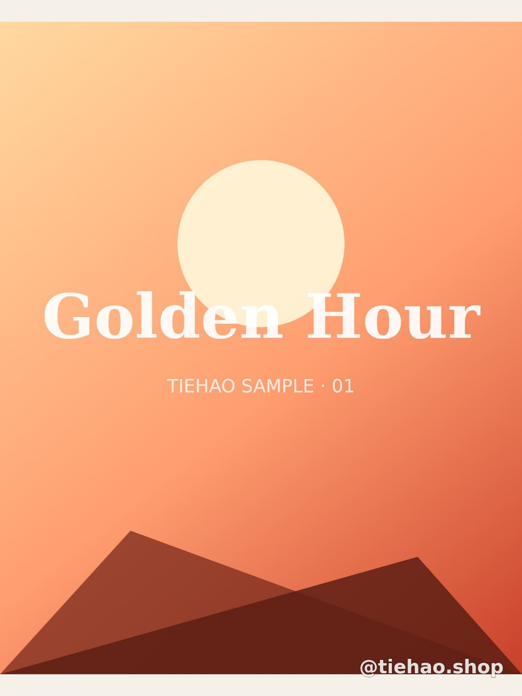

# 帖好 TieHao — 批量社媒出图工作台

把一批图片统一裁切、加品牌水印、压到目标体积，再打包成 ZIP + CSV 清单。
**全部在浏览器本地完成，图片不上传服务器，无需注册。**

在线体验版：https://wl-2598.github.io/tiehao/ （也可直接打开仓库根目录的 `index.html`）



## 功能

| 能力 | 说明 |
| --- | --- |
| 画布预设 | 3:4（1080×1440）、1:1（1200×1200）、16:9（1920×1080）、9:16（1080×1920）、保持原尺寸、自定义尺寸（16–8000px） |
| 适配方式 | 留白（contain，可自定义底色）/ 铺满裁切（cover，居中） |
| 文字水印 | 5 个位置、平铺满图、大小 / 透明度 / 字体 / 颜色 / 加粗 / 描边，自动配对比描边色 |
| 目标体积 | JPEG / WebP 先降质量、必要时再缩画布，尽量压进目标 KB 并保留清晰度；未命中会在队列中标记 |
| 批量导出 | 整批 ZIP（含 `manifest.csv` 清单 + 说明文件），或单张下载、只导 CSV |
| 品牌预设 | 画布 + 水印 + 压缩组合存到 localStorage，支持 JSON 导入导出、跨设备携带 |
| 输入方式 | 拖拽、点击选择、直接粘贴截图；JPEG / PNG / WebP，单张 ≤ 20MB，整批 ≤ 150MB |
| 预览 | 原图 / 效果 / 对比滑块三种模式，改设置即时重绘 |

## 版本与价格

| 版本 | 每批张数 | 价格 | 形态 |
| --- | --- | --- | --- |
| 在线体验版 | 3 张 | 免费 | 网页，`public/index.html` |
| 离线批量版 | 30 张 | ¥29 一次买断 | 单个 HTML 文件，双击即用，可完全断网 |

离线版不依赖任何外部脚本、样式、字体或图片，断网、放进 U 盘、发给同事都能直接跑。
收款链接在 `src/config.js` 的 `checkoutUrl` 里配置，构建时注入页面。

## 本地运行

```bash
npm install

npm run dev        # 构建并启动本地预览（http://localhost:4173）
npm run build      # 生成 public/index.html（在线版）+ product/TieHao-Offline.html（离线版）
npm run preview    # 压缩构建 + 本地预览
npm test           # 单元测试 + 运行时冒烟 + 真实像素端到端（Vitest）
npm run test:e2e   # 浏览器端到端（Playwright，需先 npx playwright install chromium）
npm run package    # 把离线版打成 product/TieHao-Offline-v1.0.0.zip
```

`npm run build` 之后根目录的 `index.html` 会同步为在线版，方便直接从仓库根目录部署（GitHub Pages 开箱可用）。

## 目录结构

```
src/
  config.js            产品名、价格、额度、单张/整批上限、收款链接
  core/                纯逻辑，可独立测试
    settings.js        画布预设、格式、水印选项、设置归一化（localStorage 存档与导入都走它）
    canvas-plan.js     画布尺寸、contain/cover 计算、水印排布、压缩阶梯
    pipeline.js        解码（含 EXIF 方向）→ 合成 → 编码到目标体积
    zip.js             ZIP 结构与 manifest.csv
    store.js           品牌预设存储（localStorage，可降级内存）
    samples.js         运行时绘制的示例图（不依赖任何图片资源）
    format.js          字节/体积/CSV/下载等工具
  app/
    main.js            工作台交互：队列、预览、批量处理、导出、预设
    ui.js              提示条、弹窗、滚动渐显、数字滚动
    icons.js           内联 SVG 图标
  site/template.js     单页模板（落地页 + 工作台），构建时注入 CSS/配置/脚本/许可
  styles/main.css      设计系统
build.mjs              esbuild 打包 + 单文件注入 + 本地预览服务
scripts/               page 检查、离线包打包、展示素材生成
test/                  单元测试、happy-dom 运行时冒烟、真实像素端到端
```

## 设计与实现要点

- **零外部请求**：页面不引用 CDN、外部字体或图片；图标是内联 SVG，示例图在运行时用 Canvas 画出来。离线版因此可以完全断网使用。
- **压缩策略**：先按设定质量编码；超标则逐步降低质量（至 0.35），仍超标再按 0.9→0.5 缩小画布，取第一个满足目标 KB 的结果。PNG 为无损格式，忽略目标体积。
- **水印可读性**：根据水印颜色亮度自动加浅色/深色描边，避免压在复杂背景上看不清。
- **健壮性**：单张 40MP、输出画布 64MP 上限；损坏的 localStorage 存档不会让页面崩掉；不支持的文件会给出中文原因。
- **无障碍**：键盘可达的队列与预览模式、`aria-live` 状态播报、`prefers-reduced-motion` 下关闭动画。

## 测试

```
test/format.test.js           字节格式化、CSV 转义、重名去重
test/settings.test.js         设置归一化（非法值纠正）
test/canvas-plan.test.js      画布尺寸、contain/cover、水印位置与平铺、压缩阶梯
test/store.test.js            预设保存/更新/导入导出/损坏存档
test/zip.test.js              manifest.csv 结构与转义
test/smoke.dom.test.js        构建产物在 happy-dom 里真实执行：图标、设置联动、队列、预设、弹窗
test/pipeline.canvas.test.js  用 @napi-rs/canvas 跑真实像素：留白底色、铺满裁切、水印真的画上去、目标 KB 命中、ZIP 解包
test/build.test.js            构建产物自包含、占位符替换、离线版无外部引用
```

## 技术与许可

产品自身代码 MIT（见 `LICENSE`）。打包使用 [JSZip](https://github.com/Stuk/jszip)（MIT / GPLv3 双许可，本项目取 MIT），许可声明随页面底部折叠区与离线包内 `LICENSES.txt` 一起分发。

画布尺寸为常用工作画布，非各平台官方强制规范；发布前请以平台最新要求为准。

## 已知限制

- 不支持 HEIC、SVG、GIF 动图、RAW；请先导出为 JPEG / PNG / WebP。
- 中文水印使用系统字体渲染，输出效果取决于本机已安装字体（这是保证完全离线的代价）。
- 极小的目标体积（例如 1080px 画布压到 20KB 以下）会自动缩小画布，可能牺牲细节。
